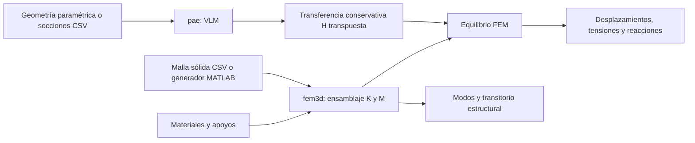

# Arquitectura y convenciones

## Componentes



La ruta principal es `fem3d.one_way`. Calcula la aerodinámica una vez sobre la
geometría inicial, transfiere fuerzas y resuelve un sólido lineal. No existe
una flecha de actualización geométrica desde el sólido hacia el VLM en esa
función.

El paquete `pae` también contiene un modelo reducido con actualización de la
superficie y cargas cuasiestacionarias. Es una herramienta distinta: recibe
matrices reducidas y una base cinemática. Los ejemplos incorporados de esa ruta
usan rigideces y masas ilustrativas, no calculadas del CAD. Consultar el
[modelo reducido](reduced-model.md) antes de interpretar sus resultados.

## Organización de archivos

| Ruta | Función |
| --- | --- |
| `matlab/+fem3d/` | Elemento sólido, mallas, ensamblaje, restricciones, equilibrio y dinámica. |
| `matlab/+pae/` | Superficie, VLM, mapas de fuerzas y solver reducido. |
| `matlab/run_*.m` | Entradas reproducibles de los ejemplos. |
| `matlab/tests/` | Referencias analíticas, conservación e integridad geométrica. |
| `data/reference/` | Triangulación de inspección, secciones y auditoría del CAD. |
| `data/fem_reference/` | Malla sólida inicial. |
| `data/fem_refined/` | Malla sólida refinada para el diagnóstico de convergencia. |
| `tools/` | Preparación CAD opcional y comprobación del repositorio. |
| `docs/` | Formulación, interfaces, procedimientos y estado de validación. |
| `results/` | Salidas generadas; no se versionan. |

## Ejes y unidades

El sistema de cálculo emplea `x` en cuerda, `y` en envergadura y `z` en altura.
Longitud en m, fuerza en N, masa en kg, tiempo en s, presión y tensiones en Pa.
Las funciones reciben ángulos en radianes; las tablas de ejemplos convierten
la incidencia a grados. Los gráficos convierten desplazamientos a mm y
tensiones a MPa cuando lo indican sus rótulos.

En el CAD de referencia, cuerda/envergadura/altura corresponden a X/Z/Y. Por
ello la permutación MATLAB es `[1,3,2]`; el preprocesador Python usa índices
basados en cero y registra `[0,2,1]`. Primero se permutan las coordenadas y
después se resta `surface.canonicalOriginCAD`, expresado en los ejes permutados.
No trasladar una malla o modo dos veces ni mezclar orígenes al transferir cargas.

La superficie VLM representa toda la envergadura finita. No se aplican por
defecto condiciones de simetría, placas laterales, paredes ni correcciones
del túnel. La velocidad positiva de incidencia se define como una componente
de corriente libre positiva en `z`. El giro geométrico positivo de `twist`
levanta la nariz: mueve el borde de salida hacia `-z` en la convención local.

## Orden de grados de libertad

Hay dos ordenamientos deliberadamente distintos:

| Contexto | Orden |
| --- | --- |
| Sólido `fem3d` | `ux1,uy1,uz1,ux2,uy2,uz2,...` |
| Base del modelo reducido `pae` | Todos los x, después todos los y y después todos los z: `X(:)` para `X` de N×3. |

Para el sólido:

```matlab
u = reshape(U.',[],1);     % U es N x 3
U = reshape(u,3,[]).';
```

Para una base del modelo reducido:

```matlab
X = reshape(surface.nodes,[],3);
Xdeformed = reshape(X(:)+structure.Phi*q,size(X));
```

No conectar `modes.Phi` del FEM directamente a `pae.make_model`: difieren el
orden de componentes, los nodos y el significado de sus coordenadas. Haría
falta interpolar, reordenar y proyectar las matrices de manera consistente.
El adaptador nuevo `ael.reduce` sí proyecta K/M y operadores explícitos B/O
de un sólido o una placa a coordenadas modales. No construye automáticamente
una superficie deformable `pae` ni su transferencia FSI. Ver [borde de salida](trailing-edge.md).

## Tensores y fuerzas

`epsilon=[exx,eyy,ezz,gamma_xy,gamma_yz,gamma_xz]'` usa cortantes de ingeniería.
`sigma=[sxx,syy,szz,tau_xy,tau_yz,tau_xz]'` usa tensiones cortantes físicas.
Una matriz `D` de otra convención debe transformarse antes de usarla.

`fem3d.boundary` orienta caras hacia fuera usando sus tetraedros propietarios.
En `traction`, presión positiva actúa hacia dentro. Una tracción vectorial en
Pa se aplica directamente en ejes globales. El VLM produce fuerzas por panel
en N, no presiones reales independientes para extradós e intradós.

El mapa `H` escalar actúa sobre cada componente de una matriz N×3. Su traspuesta
transfiere fuerzas; la identidad de trabajo virtual depende de utilizar
exactamente ese adjunto. La conservación no identifica una piel ni una unión
física entre piezas.

## Responsabilidades del usuario del solver

Se deben definir geometría, material, conectividad, apoyos y cargas compatibles.
Los identificadores CAD no se convierten automáticamente en materiales o
contactos. El generador NACA produce un sólido macizo truncado, no el mecanismo
del STEP. El resultado de un solver lineal tampoco adquiere grandes rotaciones
por asignarle un módulo de Young bajo.


## Extensión sobre el sólido CAD

`cad` mantiene regiones/sensores y transforma las pieles reales en una
superficie de carga material. `fem3d` aporta Tet10 y restricciones/no linealidad;
`fsi` usa la base derivada de ese sólido y el adjunto de la cinemática. `uvlm`
añade memoria aerodinámica explícita y partición fuerte. `nsflow` calcula por
separado flujo viscoso laminar sobre la envolvente auditada, con cavidades
selladas declaradas para esa variante fluida. Los contratos conservan el STEP
principal intacto. Los kernels C opcionales aceleran exactamente Biot–Savart;
la implementación MATLAB es la alternativa de referencia.

Los modelos históricos reducidos cuasiestacionarios conservan su interfaz y
sus límites; la presencia de UVLM en otro paquete no los convierte en modelos
con memoria. La [ruta CAD](cad-coupled.md) documenta las interfaces nuevas.
